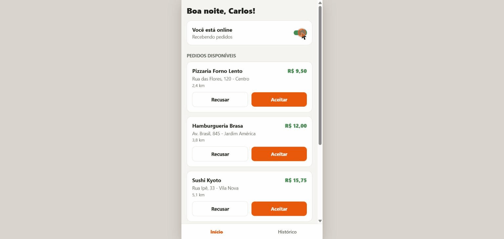

# Entregador Demo (demonstração web)

Protótipo funcional de um app de entregador, em React Native + Expo (TypeScript), exportado para a web.
Todos os dados são simulados; não há backend, pagamentos nem mapas.

**Demo ao vivo:** https://porzelt.github.io/entregador-demo-web/

Fluxo: ficar online, receber pedidos simulados, aceitar ou recusar, acompanhar os status da entrega
(a caminho da coleta, coletado, a caminho da entrega, entregue), concluir e ver o histórico com os ganhos do dia.

Este repositório contém somente o build web da demonstração. O código-fonte é entregue ao fechar o projeto.
